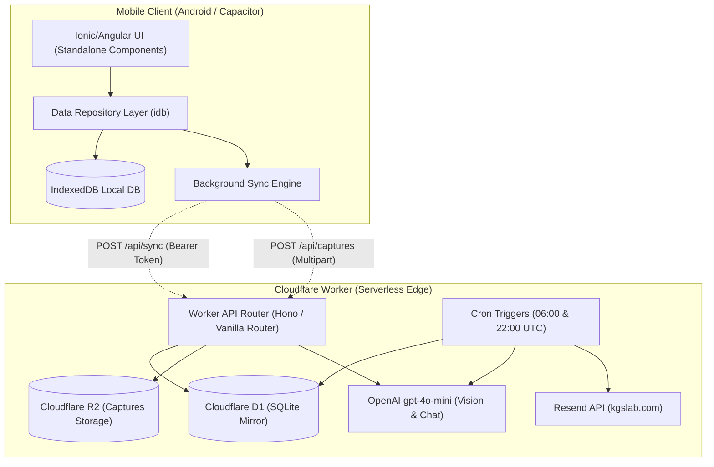
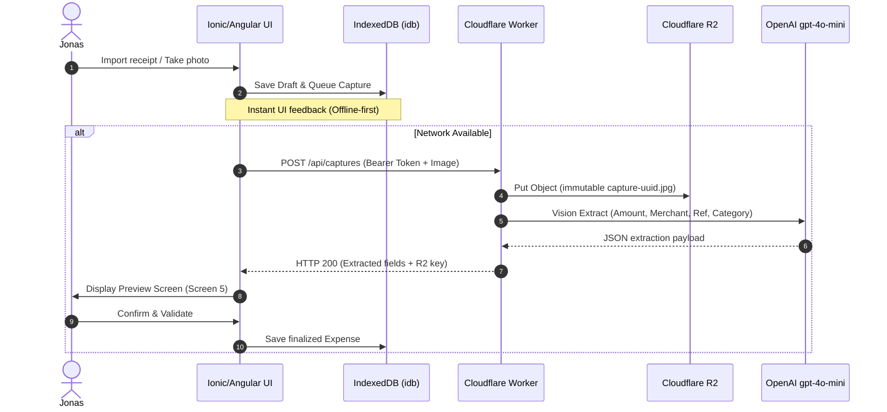

# Architecture Spine — Student Savings (SEP)

## Design Paradigm

The system follows an **Offline-First Local-Repository pattern with Serverless Edge Synchronization**. 
The mobile client operates autonomously against an embedded IndexedDB local store. User interactions are immediately committed locally and dispatched to an event-driven background sync queue. The Cloudflare Edge tier acts as a headless coordinator for cloud persistence, asynchronous scheduled jobs, OCR extraction, and persona-driven AI interactions.



## Invariants & Rules

### AD-1 — Mobile Framework & Component Architecture [ADOPTED]
- **Binds:** `FR-1`, `FR-5`, `FR-9`, all client-side UI
- **Prevents:** Framework fragmentation, inconsistent lifecycle management, and navigation state desynchronization.
- **Rule:** The mobile app must be built using **Ionic Framework with Angular** (modern standalone components) wrapped by **Capacitor Android**. All routes must use Angular router and standard Ionic navigation controllers. Direct manipulation of the Capacitor webview or non-standalone legacy Angular modules is prohibited.

### AD-2 — Local-First Single Source of Truth [ADOPTED]
- **Binds:** `FR-1`, `FR-7`, `FR-12`
- **Prevents:** UI stalls due to network latency, offline data loss, and split-brain states between local device and cloud.
- **Rule:** **IndexedDB** accessed via the lightweight `idb` wrapper is the sole authoritative source of truth for the client. All read operations (Home balance, Category budgets, Avoided Total) and write mutations (Expenses, Purchases) must execute synchronously against IndexedDB first. The UI must never await network responses to confirm local mutations.

### AD-3 — Edge Database & Cloud Mirroring [ADOPTED]
- **Binds:** `FR-4`, `FR-14`, `FR-15`
- **Prevents:** Cloud cold-start read bottlenecks, fragile server-side sync logic, and schema inconsistency.
- **Rule:** Cloud persistence must use **Cloudflare D1** (relational SQLite). D1 holds an eventual-consistency mirror of all expenses, categories, and considered purchases. Scheduled Cron Triggers compute daily/weekly budget aggregates directly via SQL queries in D1 before triggering recap emails.

### AD-4 — AI Model & Token Cap Protection [ADOPTED]
- **Binds:** `FR-9`, `FR-10`, `FR-13`, `FR-14`
- **Prevents:** Exceeding the strict monthly cost cap (~5 USD/month) and inconsistent OCR parsing results.
- **Rule:** All generative and multimodal tasks must use **OpenAI `gpt-4o-mini`**. The Cloudflare Worker must maintain an atomic monthly token counter in D1/KV. If monthly usage reaches the safety threshold, the Worker must reject non-critical chat calls with a graceful HTTP 429 response indicating that M. Pognon is resting, without affecting offline expense tracking.

### AD-5 — Event-Driven Asynchronous Synchronization [ADOPTED]
- **Binds:** `FR-1`, `FR-6`, `FR-12`
- **Prevents:** Blocking user workflows and loss of offline captures or expenses.
- **Rule:** Every local mutation appends an operation record to a `sync_queue` store in IndexedDB with `status: 'pending'`. When network connectivity is active (via Capacitor Network plugin), the queue flushes FIFO to `POST /api/sync`. Upon server HTTP 200 acknowledgment, the local queue items are marked `synced`.

### AD-6 — Zero-Exposure Secret Management & Bearer Authentication [ADOPTED]
- **Binds:** Feature-specific NFRs (Section 4.4 PRD)
- **Prevents:** Leaking OpenAI, Resend, or Cloudflare API keys within the decompiled Android APK.
- **Rule:** The mobile client holds **zero external service credentials**. All communication with the Cloudflare Worker requires a single static `Authorization: Bearer <APP_SECRET_TOKEN>` header injected at build time. The Worker securely holds `OPENAI_API_KEY`, `RESEND_API_KEY`, and R2 bucket bindings. Endpoints without a valid bearer token must return HTTP 401 immediately.

### AD-7 — Aggregated AI Persona Context [ADOPTED]
- **Binds:** `FR-13`, `FR-14`
- **Prevents:** Leaking user financial privacy, blowing the LLM context window, and inflating token bills.
- **Rule:** The chat endpoint `POST /api/chat` and scheduled email prompts must receive only **pre-computed budget summaries** (e.g. Month total, remaining daily allowance, top 3 category percentages, current severity level, and last 3 pending purchases). The raw transaction log must never be fed into the model prompt.

### AD-8 — Immutable Capture Storage Pipeline [ADOPTED]
- **Binds:** `FR-9`, `FR-10`
- **Prevents:** Data loss of market receipts and accidental capture deletions.
- **Rule:** Receipt photos and mobile-money screenshots must be uploaded as `multipart/form-data` to `POST /api/captures`. The Worker writes the binary stream directly into **Cloudflare R2** with an immutable UUID key, triggers `gpt-4o-mini` vision extraction, and returns structured draft metadata to the client. Captures are never deleted from R2.



## Consistency Conventions

| Concern | Convention |
| --- | --- |
| **Entity IDs** | Client-generated UUIDv4 strings for all Expenses, Purchases, and Captures. |
| **Timestamps** | ISO 8601 UTC strings (`YYYY-MM-DDTHH:mm:ss.sssZ`). Displayed locally in Ghana Time (UTC). |
| **Monetary Quantities** | Stored as floating decimals rounded to 2 decimal places with strict currency tag (`currency: 'GHS' \| 'XOF'`). |
| **Error Handling** | Standardized JSON envelope: `{ success: false, error: { code: 'STRING_CODE', message: 'User friendly explanation' } }`. |
| **File Structure** | Feature-grouped Angular structure (`src/app/features/{home, hesitation, capture, budget, chat}/`). |
| **Cloudflare Endpoints** | RESTful `/api/v1/*` routes managed in Worker code (`/sync`, `/captures`, `/chat`, `/health`). |

## Stack Seed

| Layer / Concern | Technology | Pinned / Recommended Version |
| --- | --- | --- |
| **Mobile Runtime** | Capacitor Android | `@capacitor/core` ^6.0, `@capacitor/android` ^6.0 |
| **Client Framework** | Ionic + Angular (Standalone) | `@ionic/angular` ^8.0, `@angular/core` ^18.0 |
| **Client Storage** | IndexedDB via `idb` | `idb` ^8.0 |
| **Icons & Font** | Nunito + Ionicons | Google Fonts (bundled local), `ionicons` ^7.0 |
| **Edge Serverless** | Cloudflare Workers | Node/TS runtime with `wrangler` ^3.80 |
| **Edge Database** | Cloudflare D1 | SQLite engine (Cloudflare managed) |
| **Object Storage** | Cloudflare R2 | S3-compatible API (Cloudflare native binding) |
| **Email Gateway** | Resend SDK / REST | `resend` ^4.0 via verified `kgslab.com` domain |
| **AI LLM / Vision** | OpenAI REST API | `gpt-4o-mini` (Model snapshot `gpt-4o-mini-2024-07-18`) |

## Structural Seed

```
SEP/
├── android/                         # Native Android project generated by Capacitor
├── src/                             # Ionic / Angular Client Application
│   ├── app/
│   │   ├── core/                    # Core services, auth interceptor, db engine
│   │   │   ├── db/                  # IndexedDB schema & idb repository service
│   │   │   ├── sync/                # Background sync queue & network listeners
│   │   │   └── services/            # Currency rate, M. Pognon local state
│   │   ├── features/                # Domain feature modules (Standalone components)
│   │   │   ├── home/                # Home dashboard, budget days, avoided total
│   │   │   ├── hesitation/          # "I want to buy" friction interceptor
│   │   │   ├── capture/             # Receipt upload, camera, offline queue
│   │   │   ├── preview/             # OCR review, duplicate detection
│   │   │   ├── budget/              # Category progress, purchase status
│   │   │   └── chat/                # M. Pognon chat interface
│   │   └── shared/                  # Reusable UI widgets, badges, buttons
│   ├── assets/                      # Icons, logo (app_logo_final.jpg), fonts
│   └── environments/                # Environment config (API URL, Bearer token)
├── worker/                          # Cloudflare Serverless Edge Backend
│   ├── src/
│   │   ├── index.ts                 # Main router & Cron handler
│   │   ├── routes/                  # /sync, /captures, /chat endpoints
│   │   ├── services/                # d1.ts, r2.ts, openai.ts, resend.ts
│   │   └── schemas/                 # D1 SQL migrations & validation types
│   ├── wrangler.toml                # Worker bindings (D1, R2, Cron, Env vars)
│   └── schema.sql                   # SQLite schema for Cloudflare D1
└── package.json
```

## Deferred Decisions

The following items are deliberately deferred to implementation without risking architectural divergence:
1. **Specific OCR Vision prompt phrasing:** Refined iteratively during worker implementation based on test receipt images.
2. **Exact Cron message templates:** Phrasing of 06:00 and 22:00 email digests left to implementation, constrained by deterministic severity levels.
3. **Local CSV export library:** Can use lightweight vanilla JavaScript blob export or utility library when building the settings feature.
